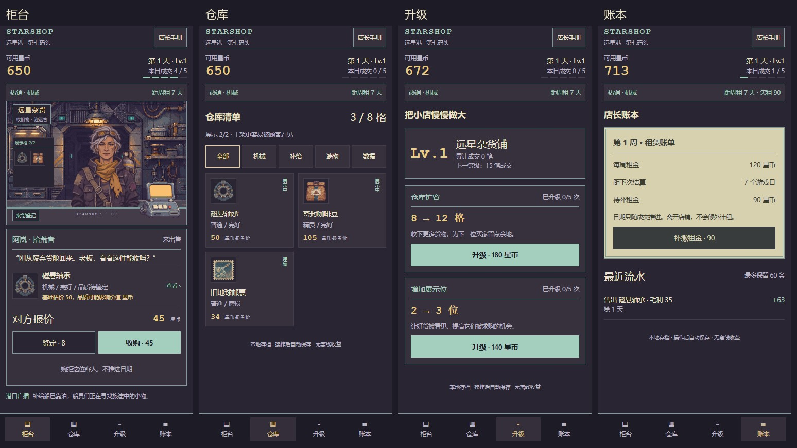

# StarShop

空间站商店模拟经营游戏首版，使用 Taro 4.3.2、React 18、TypeScript 和 Vite。H5 调试与微信小程序共用规则和界面代码。



预览来自无窗口浏览器的确定性测试状态。

## 当前内容

24 种原创商品、4 类顾客、收购与出售、一次付费鉴定、展示位、仓库扩容、店铺等级、五笔成交跨日、每周租金及欠租补缴、低价清仓、本地存档与坏档恢复入口。

规则基线见 [首版方案](docs/首版方案.md)，界面来源与截图边界见 [视觉参考](docs/视觉参考.md)。数值是首版调试默认值，尚未进行长期平衡验证。原游戏截图和素材不在本仓库。

## 运行

需要 Node.js 22、npm 10：

```sh
npm ci
npm run dev:h5
```

自行访问 `http://127.0.0.1:10086/`。开发服务只监听本机，不自动打开浏览器；结束调试后在终端停止服务。

```sh
npm run test
npm run typecheck
npm run build:h5
npm run build:weapp
npm run check
```

H5 产物为 `dist/h5`，微信小程序产物为 `dist/weapp`。微信开发者工具需由用户自行导入根目录，`touristappid` 只是开发占位，预览上传前配置自己的 AppID。尚未验证微信真机运行。

## 无窗口流程验证与截图

```sh
npx playwright install chromium --only-shell
npm run test:e2e
```

测试会自行启动和停止 H5 开发服务，只运行 headless Chromium，使用 SwiftShader 软件渲染，不打开桌面浏览器。结果位于 `artifacts/`，该目录不进入 Git。

测试包含收购／鉴定／出售／存档刷新／清仓／升级／欠租／保存失败，以及 320、375、414、768 像素宽度检查。异常与后期状态通过测试文件中的确定性夹具准备，不在正式游戏提供调试入口。

## 存档与边界

存档保存在当前浏览器或小程序本地，操作持久化成功后才更新界面；不跨设备同步。现实时间不产生收益、损耗或额外租金。当前顾客和报价随存档恢复。

存档损坏时保留原数据，重开需确认并备份旧档。清理浏览器数据会丢失本地进度。未接入登录、云服务、付费或广告。

## 目录

- `src/game/engine.ts`：纯规则、商品定义与存档结构校验。
- `src/platform/storage.ts`：Taro 本地存储适配。
- `src/pages/index/`：竖屏经营界面。
- `tests/`：规则测试；`e2e/`：无窗口浏览器流程验证。
- `docs/`：首版方案与视觉参考说明。

## 成品 Demo（五步计划交付）

```sh
npm run build:demo
```

生成 `release/StarShop-demo.html`，这是图片、代码、样式全部内嵌的离线单文件，直接用浏览器打开即可玩，不用安装依赖或联网。已验证 file:// 打开、真实交易、本地保存和刷新恢复，未发生网络请求。现代浏览器若限制本地文件存储，可以运行 `npm run demo:serve`，自行访问 `http://127.0.0.1:4179/`。

`release/StarShop-demo.zip` 是本次交付压缩包，包含 HTML 与说明；生成产物不提交 Git，可从仓库重新构建。

24 项基础价参考原 Unity 工厂方法常数，映射见 `docs/商品数值对照.md`。保持本项目原创商品名称，不声称逐物品或全部经济系统还原。

## 简笔原型与原创素材

美术按“简笔可玩版 → Unity 真实参考册 → 逐项原创替换”制作，规格见 [美术制作流程](docs/美术制作流程.md)，逐项来源、提示词和运行时规格见 [素材清单](docs/素材清单.json)。31 项包括 24 件商品、4 类顾客、店铺背景、交易终端、鉴定工具。界面文字、按钮和边框使用 Taro 组件绘制。

```sh
npm run build:sketch
```

生成可独立游玩的 `release/StarShop-sketch.html`。之后执行 `npm run build:demo` 重新生成原创美术版，简笔版文件会保留。简笔图保存在 `src/assets/sketches/`，正式图按 `items/`、`visitors/`、`room/` 分类。

原作图片与高清原创原稿留在本机 `D:/mydoc/probably-stolen-rea/starshop-art/`。`comparison-catalog.html` 为包含简笔、真实参考、原创成品的离线素材册；该目录不提交仓库。内置图像生成工具负责原创绘制，Python 只负责静态提取、预览排版和运行时尺寸打包。旧版代码像素绘制脚本仅输出到 `artifacts/legacy-pixel-assets/`，不覆盖正式美术。

```sh
python scripts/check-art.py
```

检查 31 项正式图片的尺寸、透明通道与校验值。制作脚本依赖 Pillow；`prepare-art-catalog.py` 还需要本机 REA 工具目录中的 UnityPy 和用户提供的游戏文件，普通构建和游玩不需要这些依赖。
