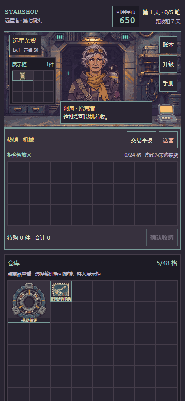

# StarShop

Taro 4.3.2 + React 18 + TypeScript 的竖屏经营 Demo。v0.3 按“手机端简化原作”重做经营流程和工作台布局，规则以 [首版方案](docs/首版方案.md) 的v0.3部分为准。



主界面采用已有原作截图的空间关系：左展示柜、中顾客、右工具、柜台暂放、下方仓库；交易和账本以纸面平板打开。素材沿用已认可的31项原创重绘，本轮不启动原游戏或桌面程序。

## 已实现

- 三个有真实坐标、占地、旋转与碰撞的区域：仓库、柜台、展示柜；点选放置与自动找位。
- 顾客来货先暂放，成交后才取得归属；1～3件选购、批量成交、同客继续交易。
- 未知品质、卖家声明、买前/买后鉴定；报价可能高于真实价值，不保证每件都赚钱。
- 独立顾客预算、品质/状态偏好、展示引导需求；一次还价与声望/等级反馈。
- 五笔成交日结，第七日主动交租、部分支付/明确延期/补缴；无离线收益和惩罚。
- 零资金空仓理货恢复、存档先写后生效、旧v1档备份迁移、坏档保留。
- UI与单步游玩接口共用规则；公开观察不输出隐藏品质、随机状态或议价容忍度。

操作顺序：交易平板挑货→暂放→确认收购→点自有货物整理→选格子/旋转/自动放置→匹配买家→报价出售。每次确认算一笔，批量仍算一笔。送客后才能接下一位。

## 直接游玩

打开本机 `release/StarShop-demo.html`，代码、样式、图片均内嵌，无需安装依赖或联网。若浏览器限制file://本地存储：

```sh
npm run demo:serve
```

自行访问 `http://127.0.0.1:4179/`，脚本不会打开浏览器。生成产物不提交Git，可从源码重新构建：

```sh
npm run build:demo
```

## 开发与验证

需要Node.js 22、npm 10。

```sh
npm ci
npm run dev:h5
npm run typecheck
npm test
npm run build:h5
npm run build:weapp
npm run test:e2e
npm run test:demo
```

开发服务地址 `http://127.0.0.1:10086/`，仅监听本机、不自动打开浏览器。H5产物在dist/h5，小程序在dist/weapp；微信开发者工具由用户自行导入。尚未验证微信真机。

Playwright始终使用headless Chromium + SwiftShader，不使用桌面鼠标键盘控制。需要时用 `npx playwright install chromium --only-shell` 安装浏览器运行时。测试状态夹具仅用于边界功能；完整周验收从真正新局开始，逐次提交正常动作，未注入日期、资金或顾客。

详情见 [验证记录](docs/验证记录.md)、[经济与流程设计](docs/经济与流程设计.md) 和 [视觉参考](docs/视觉参考.md)。

## 单步游玩接口

H5提供 `window.starshop.observe()` 与 `window.starshop.act(request)`。每次观察后决定一个操作，act必须携带token、唯一id和理由。近200条操作保留审计与幂等收据；保存失败不公布新状态。无加钱、跳日或生成物品入口。

不启动浏览器的独立CLI：

```sh
npm run play -- --file artifacts/play/shop.json init
npm run play -- --file artifacts/play/shop.json observe
```

完整格式见 [单步游玩接口](docs/单步游玩接口.md)。CLI档与浏览器档独立，没有自动通关命令。

## 存档

v2存档保存布局、未鉴定信息、当前顾客/预算、暂放、日结、租金与随机状态。首次读取旧v1档会先备份再迁移；迁移失败保留原数据，不静默重置。操作写入成功后才更新界面。没有云同步，清除浏览器数据会丢失进度。

## 素材与数值

24商品、4顾客、场景、终端、放大镜均沿用原创素材。真实原作截图仅存于本地逆向工作区，未复制进产品或仓库。数值表仅证明24项基础价的来源映射，不代表原作完整经济系统；部分是异类价位参考，明确记在 [商品数值对照](docs/商品数值对照.md)。

`npm run build:sketch` 生成可玩简笔素材版本；随后再运行build:demo恢复正式图版本。素材规格与来源见 [美术制作流程](docs/美术制作流程.md)、[素材清单](docs/素材清单.json)。`python scripts/check-art.py` 可核验31项正式图文件。

## 目录

- src/game/catalog.ts、grid.ts、engine.ts：商品、格子和纯经营规则。
- src/game/interface.ts：玩家观察、单步操作、审计和持久化控制。
- src/platform/storage.ts：Taro存储与旧档迁移。
- src/pages/index/：工作台、格子交互、平板与日结。
- tests/、e2e/：规则、完整周流程、浏览器和资源检查。
- scripts/play.ts：独立单步CLI；docs/：方案和证据说明。

当前验证覆盖首周与多种边界状态，长期经济平衡、微信真机和正式发行仍需后续验证。
