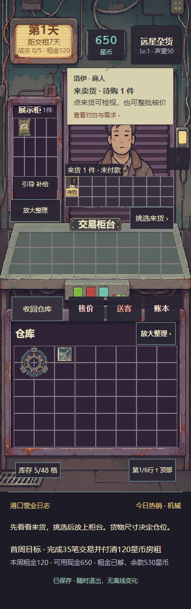

# StarShop

Taro 4.3.2 + React 18 + TypeScript 的竖屏经营 Demo。当前 v0.6 保留实物搬运和柜台买卖，并完成手机界面、触控与信息层次打磨；规则以 [首版方案](docs/首版方案.md) 的 v0.6 部分为准。



[查看32项修复与复测](docs/移动端打磨与复测-v0.6.md) · [打开截图与前后对照](docs/reviews/mobile-v06/index.html)。

主界面延续已确认的原创店面与人物。新增顾客台面；仓库、展示柜、交易柜台都可直接拖动物品，绿色落点合法、红色落点无效。拖动时按 R 旋转、Esc 取消；手机触摸拖动走同一规则，亦保留查看详情和快捷转移。跨区移动不产生付款。

## 已实现

- 来货从顾客台面拖到柜台才进入待购；可拖回撤销，未付款不得拖入自有区域。
- 确认收购后才扣款并取得归属，货物仍在柜台；自行拖入仓库/展示柜，或按↓收回。
- 独立整批折扣报价与确认；现金或柜台容量不足时整批交易保持原状。
- 出售报价由柜台实物生成，逐件显示类别、品质、数量及重复品拒收原因；超过预算可以摆货但不能成交。
- 只移除实际售出的子集，未售货留台；顾客共享预算，同客可继续交易，主动送客才换人。
- 展示柜按各类别合计公开估值预览吸引方向，影响随后普通买家；连续模式不生成原作整日队列。
- 保留五笔日结、每周120房租、一次简单还价、今日热销、固定升级、无离线收益惩罚。
- v3存档保存来货位置、台面未付款报价、预算、日结与租金；旧v1/v2先备份后迁移。
- 原有8币揭示品质暂作简化功能保留，工具鉴定、标签、容器与复杂剧情延期。

操作顺序：拖动来货上柜台 → 平板核对报价 → 确认收购 → 收回或拖入展示柜 → 接待买家 → 将自有货摆上柜台 → 核对接受/拒收与预算 → 确认出售 → 收回未售货。整批收购独立于挑选；每次确认只算一笔。

## 直接游玩

打开本机 `release/StarShop-demo.html`，代码、样式、图片均内嵌，无需安装依赖或联网。若浏览器限制file://本地存储：

```sh
npm run demo:serve
```

自行访问 `http://127.0.0.1:4179/`，脚本不会打开浏览器。生成产物不提交Git，可从源码重新构建：

```sh
npm run build:demo
```

## 开发与验证

需要Node.js 22、npm 10。

```sh
npm ci
npm run dev:h5
npm run typecheck
npm test
npm run build:h5
npm run build:weapp
npm run test:e2e
npm run test:demo
```

开发服务地址 `http://127.0.0.1:10086/`，仅监听本机、不自动打开浏览器。H5产物在dist/h5，小程序在dist/weapp；微信开发者工具由用户自行导入。尚未验证微信真机。

Playwright始终使用headless Chromium + SwiftShader，不使用桌面鼠标键盘控制。需要时用 `npx playwright install chromium --only-shell` 安装浏览器运行时。测试状态夹具仅用于边界功能；完整周验收从真正新局开始，逐次提交正常动作，未注入日期、资金或顾客。

详情见 [验证记录](docs/验证记录.md)、[经济与流程设计](docs/经济与流程设计.md) 和 [视觉参考](docs/视觉参考.md)。

## 单步游玩接口

H5提供 `window.starshop.observe()` 与 `window.starshop.act(request)`。每次观察后决定一个操作，act必须携带token、唯一id和理由。近200条操作保留审计与幂等收据；保存失败不公布新状态。无加钱、跳日或生成物品入口。

不启动浏览器的独立CLI：

```sh
npm run play -- --file artifacts/play/shop.json init
npm run play -- --file artifacts/play/shop.json observe
```

完整格式见 [单步游玩接口](docs/单步游玩接口.md)。CLI档与浏览器档独立，没有自动通关命令。

## 存档

v3存档保存布局、未鉴定信息、当前顾客/预算、暂放、日结、租金与随机状态。首次读取旧v1/v2档会先备份再迁移；迁移失败保留原数据，不静默重置。操作写入成功后才更新界面。没有云同步，清除浏览器数据会丢失进度。

## 素材与数值

24商品继续沿用此前原创素材；店面与四顾客改为本轮生成的分层像素素材，旧稿保留。真实原作截图仅存于本地逆向工作区，未复制进产品或仓库。数值表仅证明24项基础价的来源映射，不代表原作完整经济系统；部分是异类价位参考，明确记在 [商品数值对照](docs/商品数值对照.md)。

`npm run build:sketch` 生成可玩简笔素材版本；随后再运行build:demo恢复正式图版本。素材规格与来源见 [美术制作流程](docs/美术制作流程.md)、[素材清单](docs/素材清单.json)。`python scripts/check-art.py` 可核验31项正式图文件。

## 目录

- src/game/catalog.ts、grid.ts、engine.ts：商品、格子和纯经营规则。
- src/game/interface.ts：玩家观察、单步操作、审计和持久化控制。
- src/platform/storage.ts：Taro存储与旧档迁移。
- src/pages/index/：工作台、格子交互、平板与日结。
- tests/、e2e/：规则、完整周流程、浏览器和资源检查。
- scripts/play.ts：独立单步CLI；docs/：方案和证据说明。

当前验证覆盖首周与多种边界状态，长期经济平衡、微信真机和正式发行仍需后续验证。
