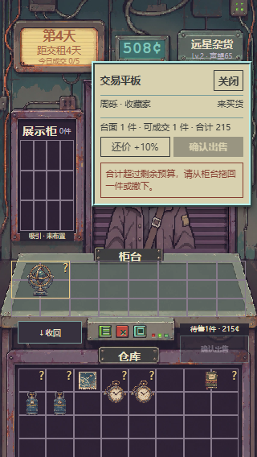
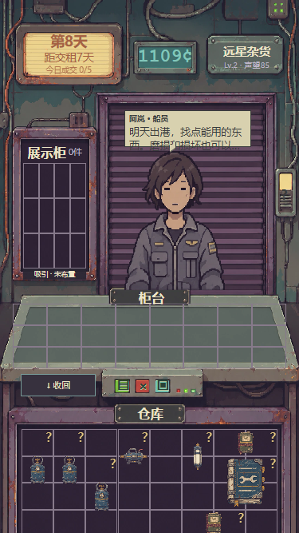
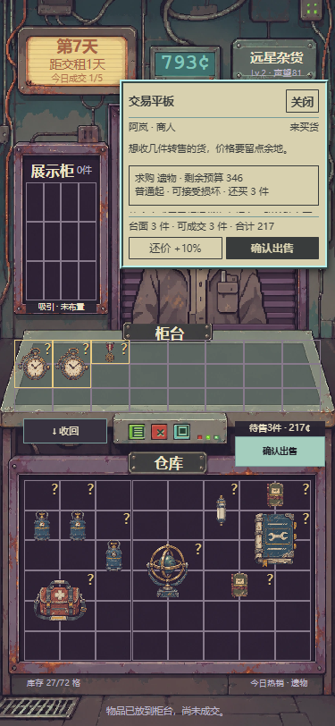

# v0.5 首周实玩与手机视觉评审

评审日期：2026-11-14。对象：当前 React/Taro 独立 HTML Demo，游戏代码基于 `2e763de`。本次只增加评审材料和测试辅助工具，没有修改游戏规则、画面或用户存档。

**结论：首周经营流程能够完成，但目前还不能作为合格的手机成品交付。** 最严重的问题是错误提示挤没交易内容，以及短屏无法看到、也无法滚到完整仓库。可玩通不代表视觉与操作合格。

[打开带图证据册](reviews/mobile-v05/index.html) · [35 笔交易记录](reviews/mobile-v05/transactions.json) · [完成首周后的公开状态](reviews/mobile-v05/completed-state.json) · [测量与覆盖摘要](reviews/mobile-v05/summary.json)

## 实玩结果与边界

当前游戏没有最终结局或胜利界面，因此不能声称“整个游戏通关”。本次完成现有 Demo 的首周目标：**35 笔交易 → 第七日日结 → 支付 120 星币房租 → 第八天继续营业 → 刷新核对存档**。

| 指标         | 结果                                                                                                                                               |
| ------------ | -------------------------------------------------------------------------------------------------------------------------------------------------- |
| 开始状态     | 第一天，650 星币，默认初始库存                                                                                                                     |
| 完成状态     | 第八天，35 笔交易，1109 星币，欠租 0                                                                                                               |
| 房租         | 第七日账单 120，已付 120，未延期                                                                                                                   |
| 成长         | 等级 2，仓库升级一次，48 格扩为 72 格                                                                                                              |
| 剩余库存     | 8 件，21/72 格；没有测试到满仓                                                                                                                     |
| 正常操作覆盖 | 接客、挑货、直接触屏拖动、检视后搬货、单件收购、整批收购、拒绝报价、还价、鉴定、展示引导、撤回商品、单件及三件合售、升级、七次日结、付款、刷新恢复 |
| 页面运行错误 | 本次没有捕获到 `pageerror`                                                                                                                         |

主流程是 375×812 CSS 像素；额外检查 320×568、414×736、768×900，以及完成后 390×844、375×667、592×590。改变视口不是再次从头通关。63 张原始截图包含两张零交易的工具预检图，其余 61 张来自本次连续经营及事后尺寸检查；证据册保留关键截图。

采用独立、临时的 headless Chromium 上下文，SwiftShader 渲染，触屏事件拖动，通过按钮点击操作。没有启动桌面游戏或可见浏览器，没有读取用户正在游玩的浏览器存档。每一步由评审者根据当前状态决定，不是预设从头跑到底的自动策略。只读取现有 `observe()` 的公开状态作记录，没有调用 `act()`，没有改钱、跳日、改种子或写入游戏状态。

**模拟的限制：** Playwright 的 `tap()` 会先把定位到的按钮滚入容器可见范围；这比真实玩家寻找隐藏按钮更容易。页面和容器滚动也使用测试命令，不能据此证明单手手势流畅。物品详情提供合法的搬货按钮，本次也使用它们；没有声称每次搬货都靠盲拖完成。不能把自动定位得到的成功率当成人类手指成功率。

没有覆盖破产救济、欠租延期、连续多周经济、满仓长列表、不同字体设置、iOS Safari、微信开发者工具或微信真机、刘海安全区。没有以这些未测分支的“无报错”代替实际验收。

## 最应先看的三张图

### 报价失败，解释也一起消失



当时买家剩余预算为 **191**，柜台报价 **215**。界面只能看到合计和“超过预算”的提示，看不到 191，也看不到要撤哪件。375 和 768 宽也出现同类问题，并非仅最小屏幕。

### 短屏仓库被截，页面滚动不能找回来



尝试 `window.scrollTo(0,999)` 后 `scrollY` 仍为 0，文档高度仍为 667；仓库下部、容量和操作反馈未露出。这不是“玩家再向下划一下”就已验证能解决的问题。

### 三件合售，只看到合计，看不到完整报价



三件合计 217 可以成交，但物品清单被挤到平板下沿。玩家必须在很小的内部区域滚动才能确认卖掉什么；屏幕上同时出现两处“确认出售”。

## 优先级与完整问题清单

共 **32 项发现与优化建议：P0 2 项、P1 10 项、P2 14 项、P3 6 项**。另列 4 项待专项验证，不计入已确认缺陷数。P0 是会遮断必要信息或区域的问题；P1 是主流程理解、点按、读数方面的高频问题；P2 是效率和反馈；P3 是完成度。下面的优化建议不等于每项都是代码故障。

### P0：先修复这两项

**01 · 交易错误提示压垮内容区。** 证据：[预算不足 375](reviews/mobile-v05/033-budget-exceeded-375.png)、[320](reviews/mobile-v05/034-budget-exceeded-320.png)、[768](reviews/mobile-v05/036-budget-exceeded-768.png)、[收藏家拒收](reviews/mobile-v05/011-collector-rejection-panel.png)。位置：`src/pages/index/index.css:1053` 附近的交易浮层、`:1096` 内容区、`:1102` 固定底栏，以及 `index.tsx:613`、`:726`。固定高度的平板内，标题与错误底栏不收缩，正文被挤出视野。建议增加平板可用高度或自适应任务布局，保留正文最小可视高度，错误说明与正文共同滚动或限行展开。验收：正常、空柜台、全部拒收、超预算、现金不足五种状态均能看见顾客限制及至少一条完整商品明细；预算与合计同时可见，关闭和确认按钮不丢失。

**02 · 短屏主场景被裁切，外层不能滚动。** 证据：[375×667 原始](reviews/mobile-v05/057-completed-375-667.png)、[尝试滚动后](reviews/mobile-v05/059-short-phone-after-page-scroll.png)、[592×590](reviews/mobile-v05/060-completed-592-590.png)。位置：`index.css:5`、`:14` 固定场景比例、`:330` 左右的仓库定位，需一起检查 Taro 页面滚动容器。建议按可用高度安排功能区，或提供明确、真正可滚动的工作区；不能将整个画面继续等比缩小来牺牲字和触控。验收：所测短屏都能访问所有仓库行、容量、反馈、交易按钮；外层与仓库内层滚动边界清楚，没有不可达区域。

### P1：主流程必须达到手机可用

**03 · 顾客对白截断，缺少完整阅读入口。** 证据：[第八天](reviews/mobile-v05/055-completed-reloaded.png)、[预算状态](reviews/mobile-v05/034-budget-exceeded-320.png)。位置：`index.css:177`、`:209`，`index.tsx:369`。气泡限制高度并截两行，姓名还占一行。建议需求摘要与闲聊分开；气泡点开可读全文。验收：最长现有对白没有半行残字，交易要求无需从被截断的句子猜。

**04 · 接客/平板、送客、账本按钮过小且相邻。** 证据：[主界面](reviews/mobile-v05/055-completed-reloaded.png)。位置：`index.css:260`、`:271`，`index.tsx:421`、`:432`、`:446`。实测三个按钮 320 宽约 17×17、375 宽约 19×20 CSS 像素。建议保留像素图标造型但扩展独立热区，并在首次使用时显示名称；送客与常用操作留出距离。验收目标：主要触控入口至少 44×44，热区不重叠；44 是本项目设计目标，不是本次测得的人类操作成功阈值。

**05 · 顾客货架/展示柜格子太小，商品难以拾取。** 证据：[首次来货](reviews/mobile-v05/001-first-offer.png)、[重复小商品](reviews/mobile-v05/038-tiny-duplicate-items.png)。位置：`index.css:971` 顾客台尺寸与 `:105` 展示柜，`GridInventory.tsx:99`。375 宽怀表只有约 28×34；1×1 的小件更小，展示柜也明显小于仓库格。建议保留真实格子占地，同时提供放大整理视图、长按选中与点选目的地，扩大可选入口而不让相邻格热区重叠。验收：手机能区分并拾取相邻两件 1×1 商品，不依赖精确点中十几像素。

**06 · 关键辅助字小到不适合手机连续阅读。** 证据：[320 窄屏](reviews/mobile-v05/034-budget-exceeded-320.png)、[390 主界面](reviews/mobile-v05/056-completed-390-844.png)。位置：`index.css:58`、`:125`、`:419`、`:982`。320 宽进度约 8.64px、展示提示约 7.8px、反馈约 9.36px。建议交易信息正文以 14–16px 为设计目标，标签至少达到可靠可读尺寸；不再让功能字体随整张背景缩小。验收：按原始尺寸看截图，价格、限制、来货归属、进度都不需要放大页面。

**07 · 核价和批发入口默认藏在内滚动区。** 证据：[初次打开平板](reviews/mobile-v05/001-first-offer.png)、[批发确认](reviews/mobile-v05/002-wholesale-confirm.png)。位置：`index.tsx:633`、`:687`，`index.css:1096`。首客平板默认主要是操作说明，实测整批按钮初始可见比例为 0。建议顾客概况旁直接给“逐件/整批”入口；保留首次简短引导及溢出提示。验收：新玩家不读手册、不靠工具自动滚动，也能找到来货、单价查看和整批报价。

**08 · 多件报价缺少可快速核对的明细视野。** 证据：[三件报价](reviews/mobile-v05/046-three-item-sale-quote.png)、[滚动到底](reviews/mobile-v05/047-three-item-sale-bottom.png)。位置：`index.tsx:650` 报价行、`:726` 汇总。建议让报价单获得足够区域，固定预算/总额/成交数量，列表可正常滚动并显示项数。验收：能逐项确认名称、接受/拒收、价格；三件不会只剩合计可看，长列表也不会失去总额。

**09 · 同时有两处确认交易，层级与结果关联不清。** 证据：[双确认出售](reviews/mobile-v05/046-three-item-sale-quote.png)。位置：`index.tsx:455` 主柜台条、`:726` 平板底栏。建议在当前工作状态中只突出一个主要确认入口；若保留快捷入口，应共享同一清晰报价摘要。验收：玩家能说明本次卖几件、多少钱、哪些留下，且不会因两处按钮以为是两个交易阶段。

**10 · 待购与自有物品区分不够直接。** 证据：[来货与库存](reviews/mobile-v05/007-two-incoming-items.png)、[收购后](reviews/mobile-v05/003-first-bought.png)。位置：`GridInventory.tsx:99`、`:140`，`index.css:569` 将紧凑格的“待购”隐藏。当前主要靠虚线，问号又表示品质未知，容易混淆。建议保留小型文字或明确归属标识、待购区标题及已付款反馈。验收：未付款货在柜台时不被误认为自有，问号不承担所有权含义；已购货的状态切换可见。

**11 · 送客是无文字小叉号，误触代价大。** 证据：[底部控制台](reviews/mobile-v05/055-completed-reloaded.png)。位置：`index.tsx:432`。与弹窗关闭的视觉语义相近，紧邻平板入口。建议加“送客”文字/提示；尚有待报价物品时提供轻量确认，并明确哪些会被带走。验收：不把关面板与送客混淆，关闭弹窗不离客，关键待办状态下误触不会直接丢失当前报价机会。

**12 · 预算、需求、剩余购买数在主场景缺席。** 证据：[买家主界面](reviews/mobile-v05/040-day5-customer.png)、[预算不足](reviews/mobile-v05/033-budget-exceeded-375.png)。位置：`index.tsx:365` 气泡、`:623` 需求只在平板。建议主界面固定简洁的“来买/卖、类别、预算/报价、还能买几件”；详细限制放次级展开。验收：先搬货前就能判断是否值得拿货，不必反复打开平板记预算。

### P2：连续经营时的效率与反馈

**13 · 同种小商品难以分辨，未知问号抢占图形。** 证据：[两枚怀表/勋章](reviews/mobile-v05/038-tiny-duplicate-items.png)。位置：`GridInventory.tsx:133`、`index.css:384`。建议选中后显示名称、状态、成本与对应高亮，问号缩成状态徽记；提供同品比较。验收：同种不同状态货可稳定区分，不需要来回记坐标。

**14 · 来货详情未就地展示该件当前收购价。** 证据：[初始来货检视](reviews/mobile-v05/002-incoming-detail-375.png)。位置：`index.tsx:904` 商品详情。估值、声明、占地都有，真正报价需搬上柜台再看。建议在不改变“搬货不付款”规则下，详情显示“卖家当前要价”，并将参考估值明确区分。验收：玩家能在同一视野比较估值与要价，无法把估值误认成实付。

**15 · 还价结果离操作位置太远。** 证据：[还价后](reviews/mobile-v05/029-seller-bargain-feedback.png)。位置：`index.tsx:735`、`:555`，`index.css:419`。按钮变“已还价”，结果主要在场景最下方的通知，短屏看不到。建议在平板内显示接受/拒绝与变化前后价格；全局通知仅作补充。验收：不离开当前报价区即可知道还价结果及新的总价。

**16 · 成交缺少足够明确的局部回执。** 证据：[首笔收购后](reviews/mobile-v05/003-first-bought.png)、[三件出售后](reviews/mobile-v05/048-three-item-sale-finished.png)。位置：`index.tsx:242` 的成交处理、`:555` 通知。建议短暂展示“收购/出售 N 件、支出/到账、留台待整理/拒收保留”，可查最近一笔。验收：按钮点后玩家无需打开账本才能确认是否成交，不能把单纯搬货当付款。

**17 · 买家买够后仍像在继续求购。** 证据：[第八天买家](reviews/mobile-v05/055-completed-reloaded.png)；公开状态 `remaining:0`、预算31。位置：`index.tsx:365`、`:623`。建议显式显示“已买够/本次交易完成”，引导送客；保留顾客跨日规则。验收：剩余购买数 0 与预算不足/商品不匹配是三种能区分的状态。

**18 · 仓库扩容后，新增区域与滚动位置难发现。** 证据：[升级后](reviews/mobile-v05/027-storage-upgraded.png)、[滚到新增下部](reviews/mobile-v05/028-expanded-storage-bottom.png)。位置：`index.css:330` 附近 `.warehouse-scroll`、容量条。建议升级时标出新增三行，显示滚动位置/还有几行，提供回到顶部。验收：48→72 格变化可被看见，玩家能找到上下两端库存，不把扩容误当无效。

**19 · 现有库存缺少筛选和快速找货。** 证据：[第三天库存](reviews/mobile-v05/030-third-day-stock.png)、[第七天库存](reviews/mobile-v05/046-three-item-sale-quote.png)。位置：`index.tsx` 仓库与 `GridInventory.tsx`。建议按当前顾客需求高亮可售货；提供类别、已鉴定、状态筛选或商品列表跳转，保留格子摆放。验收：找到匹配货不需逐个点未知图标；这是当前十余件库存已显现的效率问题，不声称已压测大量库存。

**20 · 整理模式没有把所选方向与自动摆放语义讲清。** 证据：[整理工具](reviews/mobile-v05/025-placement-overlay-active.png)、[选择旋转](reviews/mobile-v05/026-rotation-selected.png)。位置：`index.tsx:528`、`:537`。自动找位调用没有传入所选 `rotated`；本次选择90°后自动摆放最终为未旋转。建议区分“按当前方向找位”和“自动尝试方向”，说明结果。验收：用户所见旋转状态与实际落位一致，自动改向也有清楚反馈。

**21 · 旋转改变格子占地，但商品图没有随之转向。** 证据：[旋转选择](reviews/mobile-v05/026-rotation-selected.png)，源码 `GridInventory.tsx:133` 使用相同的 `aspectFit` 图片，没有根据 `rotated` 设置变换。建议同步旋转图像或提供清晰方向标识，保持像素采样。验收：横放与竖放的物品方向一眼可见，不靠尺寸数字猜。

**22 · 整理工具说明细小、换行后不易读。** 证据：[整理面板](reviews/mobile-v05/025-placement-overlay-active.png)。位置：`index.css:391`、`:415`，`index.tsx:550`。建议减少一句话里的指令数量，清楚展示“已选商品/目标区域/方向/取消”；正文不缩为细密小字。验收：工具提示不被压切，目标模式与取消入口在手机原尺寸下可读可点。

**23 · 展示柜效果不够可观察。** 证据：[改展示类别](reviews/mobile-v05/013-changed-display-category.png)、[升级后展示](reviews/mobile-v05/028-expanded-storage-bottom.png)。位置：`index.css:991` 的展示提示、`index.tsx` 展示摘要。建议保留“影响概率、不保证立刻来客”的规则，显示当前引导类别及简短作用说明，放货后即时更新。验收：玩家知道展示是引导客流，不会误以为摆进去即自动售出；短小“吸引/未布置”不独自承担全部说明。

**24 · 每周租金金额在平时主界面不明确。** 证据：[平时界面](reviews/mobile-v05/040-day5-customer.png)、[房租账单](reviews/mobile-v05/049-rent-due-375.png)。位置：`index.tsx:282`、`:1043`。主界面有倒计时，120金额要进入账本或到期才能完整看到。建议倒计时旁显示本周120及已预留/差额的轻量读数。验收：无需增加生存系统，也能提前知道需要留多少钱。

**25 · 日结与新一天状态变化不够醒目。** 证据：[第三日日结](reviews/mobile-v05/031-day3-report-level2.png)、[第四天](reviews/mobile-v05/032-day4-level2.png)、[房租支付后](reviews/mobile-v05/053-rent-paid-375.png)。位置：`index.tsx:1025`、`:1088`。建议进入下一天时显示简短摘要：天数、今日热销、房租倒计时；升级解锁明确说发生了什么。验收：不依赖读很小的日历/店招即可确认新一天与成长结果。

**26 · 日结说明重要，但和操作步骤的衔接偏重阅读。** 证据：[普通日结](reviews/mobile-v05/014-day1-report.png)、[批发日结](reviews/mobile-v05/042-day5-report-bulk.png)。位置：`index.tsx:1040`。第五笔成交直接弹结算，柜台未整理货会跨日保留，需要读段落才放心。建议在成交结果与日结上简洁列出“留台 N 件/继续后可整理”，保留当前简化日结规则。验收：用户不会担心继续营业丢失刚买的货；这里是反馈改进，不建议新增强制关店长流程。

### P3：向成品补齐的细节

**27 · 账本信息层次和空间分配可改善。** 证据：[短屏账本](reviews/mobile-v05/058-ledger-short-phone.png)。位置：`index.tsx:773`。已付清仍显示大块不可用“支付房租·0”，流水阅读区相对减少。建议已付清改状态行，按天汇总收入/支出/毛利并可展开明细。验收：最先看到现金、到期责任、当天经营结果；流水可追溯每笔。

**28 · 升级条件长文换行显得零碎。** 证据：[320 升级](reviews/mobile-v05/023-upgrade-320-568.png)。位置：`index.tsx:823`、`index.css:833`。建议统一成“当前/升级后/价格/条件”四个短字段，避免等级单位单独挂行；扩仓与展示效果给出预览。验收：320宽依然能比较两种升级，购买前知道确切增益。

**29 · 手册手机指引混入桌面快捷键，初学成本偏高。** 证据：[320 手册](reviews/mobile-v05/024-help-320-568.png)。位置：`index.tsx:859`。建议触屏优先写点选/按住/取消，桌面键另列；首次买卖用两三步就地提示，不要求先读整页文字。验收：新玩家可完成第一笔合法收购及出售，能说明“移动不付款”和“拒收留台”。

**30 · 金额单位和状态文案需要统一。** 证据：[详情](reviews/mobile-v05/061-final-item-detail.png)、[交易](reviews/mobile-v05/046-three-item-sale-quote.png)、[日结](reviews/mobile-v05/049-rent-due-375.png)。位置：`index.tsx:665`、`:915`、`:1034`。¢、星币、无单位混用；来客的“来买货/来卖货”也应始终以顾客视角表达。建议制定短文案表，分别标注参考价/要价/报价/实付/毛利。验收：同一种金额不出现不同含义，低价清仓与正常出售清楚区分。

**31 · 没有把首周目标与达成结果呈现给玩家。** 证据：[付款后](reviews/mobile-v05/053-rent-paid-375.png)、[第八天](reviews/mobile-v05/054-completed-day8.png)。位置：`index.tsx:1025` 及主界面状态。建议当前 Demo 提示“完成首周并交租”的试玩目标，达成后给短反馈与“继续经营”。验收：知道目标已完成，但不误说无限经营有最终关卡；无需添加新剧情或长任务线。

**32 · 随时退出的承诺缺少可感知反馈。** 证据：[刷新后](reviews/mobile-v05/055-completed-reloaded.png)与公开状态，存档实际通过。位置：`index.tsx:95` 附近的保存路径及主状态栏。建议低干扰显示已保存/保存失败；恢复时提示日期和当前交易是否未成交。验收：关闭前无需猜是否落盘，恢复后保留顾客、货物、房租，未确认交易不被自动结算。不能为了这个改成离线收益。

## 另列：需要专项验证的四项

1. **拖动后紧接第一次点击偶尔无响应。** 本次在直接 touch 拖货后打开平板/接客有多次第一次无效果、第二次成功，其中两条等待平板底栏的命令超时。不能把它直接定性为所有手机都会吞点：可能涉及合成触摸、兼容 click 与手势抑制时序。源码 `useInventoryDrag.ts:203` 有450ms点击抑制，但它是否导致这些平板按钮失效尚未证实。应针对拖后0/200/500/1000ms分别验证真实触屏与 H5，并记录目标事件链。
2. **刘海、底部手势区、微信导航条、键盘/字号放大。** 本次只有浏览器可视口尺寸，没有真实安全区或微信容器。需确认底部主操作不被遮挡，增大字体后不重现交易挤压。不能标“微信已适配”。
3. **长时间拖动、边缘自动滚动与满仓摆放。** 已有成功拖放与升级后滚动，但没有满仓/跨多屏连续手指体验。需验证拖动与仓库滚动竞争、无效落点提示、松手取消、最后一行和左右边界，以及各种占地旋转。
4. **低性能真机的渲染和触控延迟。** SwiftShader 能产图不等于真机流畅。本次未采集可信的手机帧率、内存、功耗或P95触控延迟，因此不写“低于1G”或“流畅60帧”。应在安卓和iOS各至少一台上验证首次加载、长列表与拖动。

## 修改顺序与交付门槛

1. **先恢复信息可达性：** 01、02；加入内容长度/状态组合/短屏的截图回归。保留原画、像素场景和四区域关系。
2. **再让首客不依赖说明书：** 03–12；先能看清来货与归属，再能选货、核价、确认、整理、找买家、出售。
3. **再让重复经营不费劲：** 13–26；统一明细、反馈、仓库检索、旋转、成长与跨日状态。
4. **最后补完成度并做真机专项：** 27–32与四项待验证。每轮改动后使用同一业务场景和原尺寸截图比较，不用一张静态漂亮图替代完整流程。

“追求100分”落地为以下验收条件，而不是现在随意打一个分：

- 全部已测尺寸无不可达内容、半行残字或关键信息被错误提示挤没；长文有完整阅读入口。
- 主操作热区达到项目目标，危险操作不混同关闭；小格有可用的精确整理替代入口。
- 手机玩家在不读长手册的情况下能完成收购→自有归仓→展示→找买家→报价→撤回拒收货→出售；始终知道货归谁、钱是否已付。
- 同屏或一步内可核对需求、预算、单价、件数和合计；正常、拒收、超预算、现金不足、空柜台均有明确下一步。
- 所有重要结果就地反馈；保存/恢复、跨日留货、付租结果可确认；无离线收益与惩罚保持不变。
- 首周完整复玩通过，再补满仓/长列表/实际手指/微信真机；未完成的项如实留在未验收列表，不把“未测”写成“通过”。

## 证据与工具说明

原始运行材料在被 Git 忽略的 `artifacts/mobile-review-v05/`，包含63张截图及对应状态/DOM测量、362条操作记录（含工具预检及事后尺寸检查），其中两条定位等待超时已单列，并未当作页面运行错误隐去。证据册复制关键原图，没有裁掉错误或重绘游戏画面。`transactions.json`从操作前后交易笔数变化提取，不是根据截图手工猜测收益。

工具是 `scripts/review-player.mjs` 与 `scripts/review-command.py`：前者启动独立无窗口会话并接受显式操作，后者提交一组当前决定的动作。它们不包含选货策略和通关脚本。运行前需已有 `release/StarShop-demo.html` 与 Playwright Chromium；不要与游戏公开到局域网的服务混用。默认HTTP仅绑定127.0.0.1，输出目录通过 `STARSHOP_REVIEW_DIR` 隔离新一轮记录。

示例（两个终端，均为命令行，不产生桌面游戏窗口）：

```powershell
$env:STARSHOP_REVIEW_DIR='artifacts/mobile-review-next'
$env:REVIEW_CONTROL='http'
node scripts/review-player.mjs
```

```powershell
$env:STARSHOP_REVIEW_DIR='artifacts/mobile-review-next'
'[{"op":"observe"}]' | python scripts/review-command.py
'[{"op":"stop"}]' | python scripts/review-command.py
```

重跑必须使用新目录，避免覆盖上一轮截图。关闭测试会话会保存独立浏览器存储，并关闭属于它的Chromium；不会关闭用户浏览器。

<!-- Hallmark · review artifact only · P4 H4 E4 S5 R5 V4 · these are report-design checks, not a game score -->
