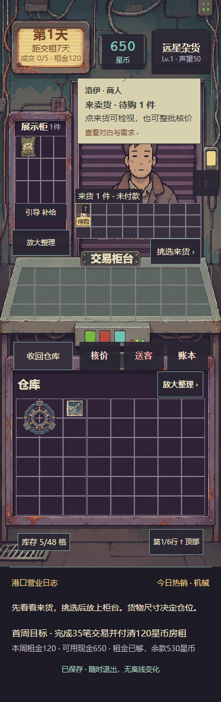

# v0.6 手机界面打磨与复测

收尾日期：2026-11-16。原始连续实玩记录保留在本次独立测试目录，未覆盖 v0.5 的评审材料。

**32项已实现并逐项复核。** 本轮把画面协调、阅读舒适、操作反馈和触屏手感一起作为交付要求。沿用已认可的原创像素美术、人物与店内四区关系；搬货、确认付款、归仓和展示仍是独立步骤，商品保留真实格子占地。

[打开38张截图与前后对照](reviews/mobile-v06/index.html) · [35笔交易明细](reviews/mobile-v06/transactions.json) · [构建指纹与状态证据](reviews/mobile-v06/summary.json)

## 可以直接体验

构建产物为 `release/StarShop-demo.html`，代码、样式、图片内嵌，可离线打开。若浏览器限制文件页面的存储，运行 `npm run demo:serve` 后自行访问本机服务。脚本不会打开桌面窗口。

## 32项实现与验证对照

编号对应[原始评审](手机试玩视觉评审-2026-11-14.md)，不另换一组容易完成的标准。

| 编号 | 已实现的处理                                                               | 验证方式或证据                                                                                                                                         |
| ---- | -------------------------------------------------------------------------- | ------------------------------------------------------------------------------------------------------------------------------------------------------ |
| 01   | 报价与挑货分区；预算、合计和确认栏固定，正文独立滚动。错误不会挤没明细     | 四种宽度预算不足回归；[320截图](reviews/mobile-v06/budget-320.png)                                                                                     |
| 02   | 解除 Taro 页面高度上限和裁切，短屏可滚到完整仓库、容量与保存状态           | 320×568、375×667、414×736、768×900；[短屏底部](reviews/mobile-v06/bottom-320.png)                                                                      |
| 03   | 气泡显示来客摘要，报价单保留完整对白；正文自然换行，不截半行字             | 真实顾客实玩、拒收与报价截图；[首客](reviews/mobile-v06/play-first-offer.png)                                                                          |
| 04   | 核价、接客、送客、账本改为有文字的独立大热区                               | 主要入口至少44 CSS像素的尺寸断言、连续轻触回归                                                                                                         |
| 05   | 四区都有放大整理；大格子44像素，另有可点的清晰商品清单                     | [格子](reviews/mobile-v06/warehouse-grid.png)、[清单](reviews/mobile-v06/warehouse-list.png)及手动落位测试                                             |
| 06   | 功能文字与背景缩放分离；提高字级、对比度、行距，日历棕色加深，容量增加实底 | 四尺寸截图；正文14–16像素，辅助说明12–13像素；小角标有清单/详情替代信息                                                                                |
| 07   | 初次打开直接看到挑货和批发报价，整批入口在挑货页固定区域                   | 首客与整批收购测试；选货只搬货，确认前现金不变                                                                                                         |
| 08   | 柜台报价集中展示所选商品、逐件价格、接受/拒收和撤下；选货后直接返回报价    | [真实三件合售](reviews/mobile-v06/play-three-item-sale.png)、多件与拒收测试                                                                            |
| 09   | 确认交易集中在报价单底栏；主柜台展示合计与核价提示                         | 同一页面确认按钮唯一性断言、三件合售只记一笔                                                                                                           |
| 10   | 来货明确标为待购；自有清单显示成本；未付款跨区仍受规则拦截                 | 拖放、非法投放、单件付款与刷新测试                                                                                                                     |
| 11   | 送客使用文字及危险色；有未购来货或报价时确认，说明归属保留规则             | 关闭不送客、取消送客保留顾客、确认后离开测试                                                                                                           |
| 12   | 主场景显示买卖方向、需求/来货数和预算摘要；平板固定完整限制                | 买家已买够状态与四宽度预算回归                                                                                                                         |
| 13   | 清单显示名称、状态、品质、成本和坐标，支持同名货区分；未知品质改为小角标   | 真实两枚纪念章不同成本的比较、筛选与详情测试                                                                                                           |
| 14   | 来货详情同时显示卖家要价、估值与声明品质，归属说明明确                     | 来货检视及未知品质测试，买入不自动鉴定                                                                                                                 |
| 15   | 还价结果与前后价格放在固定确认区，成功、拒绝、离开有明确反馈               | [成功](reviews/mobile-v06/bargain-0.8.png)、[拒绝](reviews/mobile-v06/bargain-0.2.png)、[离开](reviews/mobile-v06/bargain-0.01.png)，320宽整行可见断言 |
| 16   | 成交有轻量回执，完整记录留在营业日志；提示已付款、货物留台或拒收保留       | [真实收购回执](reviews/mobile-v06/play-purchase-receipt.png)、现金/库存/笔数断言                                                                       |
| 17   | 买够后明确显示“已买够 · 可以送客”，区分需求不匹配和预算不足                | 真实交易后及已完成顾客夹具测试                                                                                                                         |
| 18   | 扩仓前后容量预览、增加行数反馈、仓库行号及回到顶部入口                     | 真实180星币升级、最大扩仓末行操作、恢复存档复核                                                                                                        |
| 19   | 商品清单提供类别、已/未鉴定、符合顾客筛选；匹配货有高亮，空筛选有提示      | 清单筛选与新旧库存测试                                                                                                                                 |
| 20   | 自动找位使用玩家选定方向，空位不足不擅自改变方向；旧接口省略方向仍兼容     | 方向约束单元测试、真实旋转后找位和存档复核                                                                                                             |
| 21   | 格子图像跟随占地方向旋转；清单缩略图保持便于识别的展示方向                 | 图像变换断言、非方形商品的真实旋转操作                                                                                                                 |
| 22   | 整理工具明确所选物品、目标区、方向与取消；格子/清单分开，减少嵌套滚动      | 大格子选择、旋转和手动落位测试                                                                                                                         |
| 23   | 显示展示引导类别，说明影响后续客流；放货不自动销售                         | [展示规则](reviews/mobile-v06/showcase.png)、真实多次更换展示货并等待匹配来客                                                                          |
| 24   | 日历保留租金120，日志显示现金与租金差额；到期账单明确列出已付/欠款         | 平时主界面、[到期账单](reviews/mobile-v06/play-rent-due-320.png)与付款测试                                                                             |
| 25   | 新一天有简短反馈，等级解锁在日结内明确显示，租金付清显示首周达成           | [二级店铺日结](reviews/mobile-v06/play-level2-day3-report.png)、[付租后](reviews/mobile-v06/play-rent-paid.png)                                        |
| 26   | 日结直接列出留台件数、顾客保留、退出保存及继续后的整理方式                 | [批发触发日结](reviews/mobile-v06/play-day5-retained-goods.png)，跨日库存与顾客断言                                                                    |
| 27   | 账本按日筛选，显示收入、支出、毛利与明细；已付清不再出现付款0按钮          | [第七天账本](reviews/mobile-v06/ledger-day7.png)，毛利记账与旧记录兼容测试                                                                             |
| 28   | 升级列出当前级数、当前/下一级容量、价格与等级条件，使用短字段换行          | 320升级预览、真实扩仓与货位不变检查                                                                                                                    |
| 29   | 手册按收货、整理、出售写手机步骤，桌面快捷键后置；长文可滚且关闭入口保留   | [手机指引](reviews/mobile-v06/help-320.png)、[说明底部](reviews/mobile-v06/help-bottom.png)                                                            |
| 30   | 金额使用星币；要价、参考价、成本、实付与毛利各自命名；数字对齐             | 报价、详情、账本与日结的原尺寸截图复核                                                                                                                 |
| 31   | 显示35笔并付清首租的试玩目标，达成后提示继续经营                           | 真实35笔、付清120、进入第八天；当前仍为持续经营，没有虚构最终结局                                                                                      |
| 32   | 显示保存/恢复/失败状态；失败不发布操作；未确认报价、来客、货位与账单可恢复 | 损坏存档、写入失败、v1/v2迁移及真实第八天刷新恢复测试                                                                                                  |

## 对美观与舒适的额外处理

- 保留像素场景与纸面交易单，统一边线、留白、字重和按钮尺寸；取消控制台文字重影，避免字挤在纹理上。
- 放大格子使用店内深色底，纸面按钮样式不会污染仓库；格子摆放与清单分开，减少同时操作多层滚动的负担。
- 仓位栏与长通知分开，完整通知进入营业日志；短屏底部不会互相盖字。
- 清掉报价单和工具面板中无关的旧回执；成交提示简短，完整信息仍可追溯。
- H5统一轻触识别和兼容点击去重，防止拖后吞点、关闭后点击穿透、连续轻触重复付款；滑动不当作按钮点击。
- 拖到边缘并停留后才滚动，减少松手前目标被滚走的情况；保留无效落点和取消。
- 转场保持短且克制，尊重减少动效设置；字体和触控尺寸不随背景缩小。没有为了装满画面添加额外装饰系统。

## 实玩与验证结果

独立会话从默认650星币开始，经过正常挑货、搬运、确认、归仓、展示、接客与日结，完成35笔交易。期间真实支付扩仓180、鉴定8、租金120，最后为**第八天、1109星币、欠租0**。还测试了三件一次合售、拒收、超预算、旋转和跨日留货。

实玩只使用页面轻触/拖动以及只读观察。未改资金、日期、种子或顾客，没有调用状态修改接口。每步由评审者根据当前报价和库存分批决定，工具没有自动选货策略。边界夹具与这35笔经营记录分开。

连续实玩后又修正了截图检查发现的细节，并用**本次独立会话自身保存的第八天存档**恢复最终构建复核。UI复核中的整理不产生收入。原始实玩构建与最终构建的SHA256分别记录，未冒充为同一份文件。

| 检查                 | 结果                                                                  |
| -------------------- | --------------------------------------------------------------------- |
| 规则与接口测试       | 30项通过，含完整周流程、资金/归属边界、自动找位方向及毛利记录兼容     |
| 移动触屏浏览器回归   | 21项通过；含全部原创商品/顾客加载、四宽度预算、连续轻触及三种还价结果 |
| 类型检查及格式检查   | 通过；固定CSS像素文件保留Taro所需的 `PX` 大写单位                     |
| H5独立Demo与微信构建 | 通过                                                                  |
| 独立HTML离线验收     | 图片、真实购买、未知品质、保存/刷新、零外网请求通过                   |
| 原尺寸视觉复核       | 320/375/414/768宽，另检查375×667短屏；本轮图片保留原图                |

毛利是售出/清仓价格减该货成本，不包含租金。新流水记录可选毛利字段，存档仍为v3；旧销售记录可恢复已记载的毛利，旧清仓缺少成本时显示未记录，避免编造数值。

## 验证边界

这些是headless Chromium移动触屏模拟结果，不能代替微信真机。按钮定位工具会自动滚到目标，合成拖动也不能证明真人手指成功率。原图和实测尺寸能够说明可读性与区域可达性，审美仍保留人工判断。

微信导航栏/刘海安全区、系统放大字号、iOS与低性能安卓的帧率和功耗，尚未进行真机验收。本轮增加了安全区留白、减少动效支持和H5边缘滚动，后续真机验收继续检查显示、触控与性能。质量要求同时覆盖好看、清楚、顺手及细节一致，每轮依据实际画面和完整操作复核。

<!-- Hallmark · report artifact self-critique only: P5 H5 E4 S5 R5 V4 · not a game score -->
